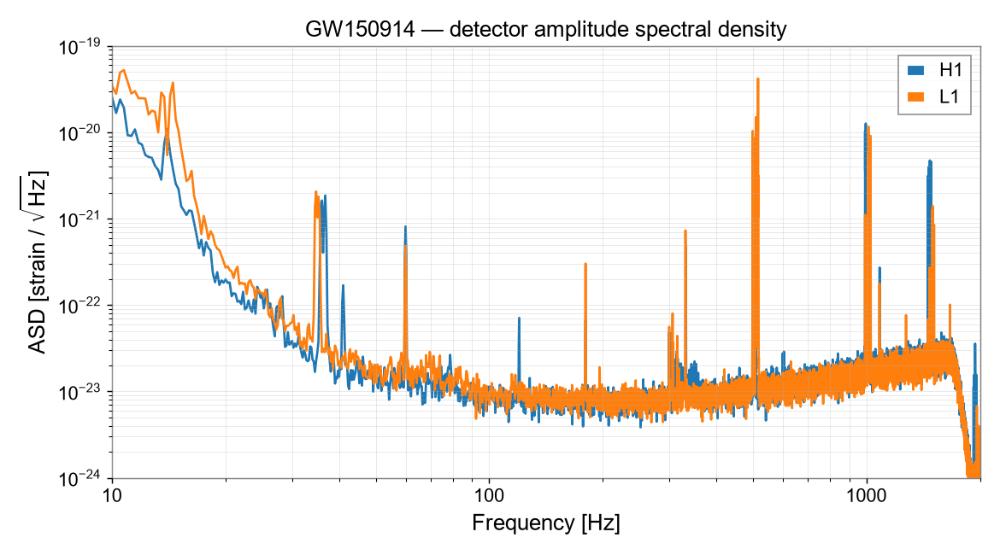
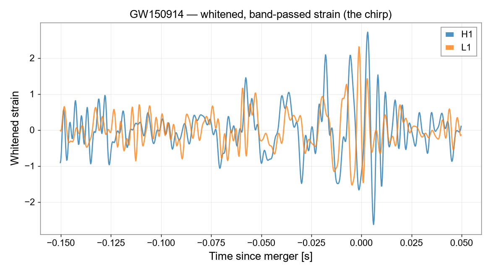
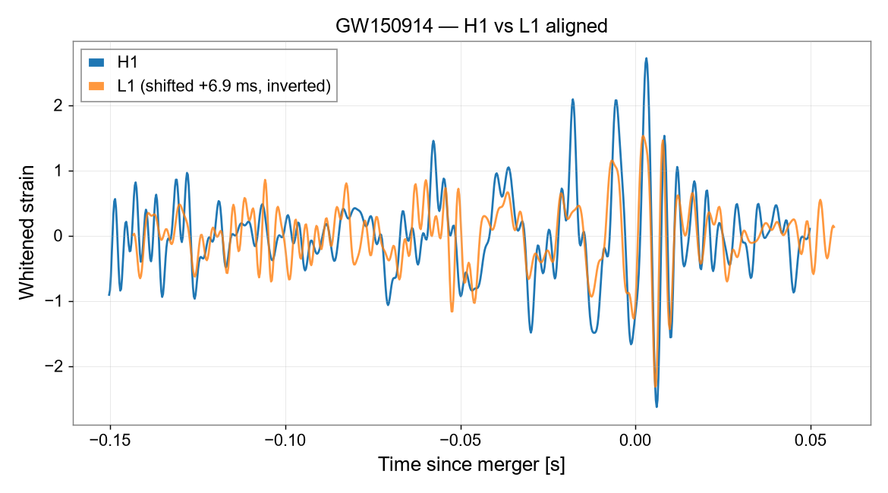
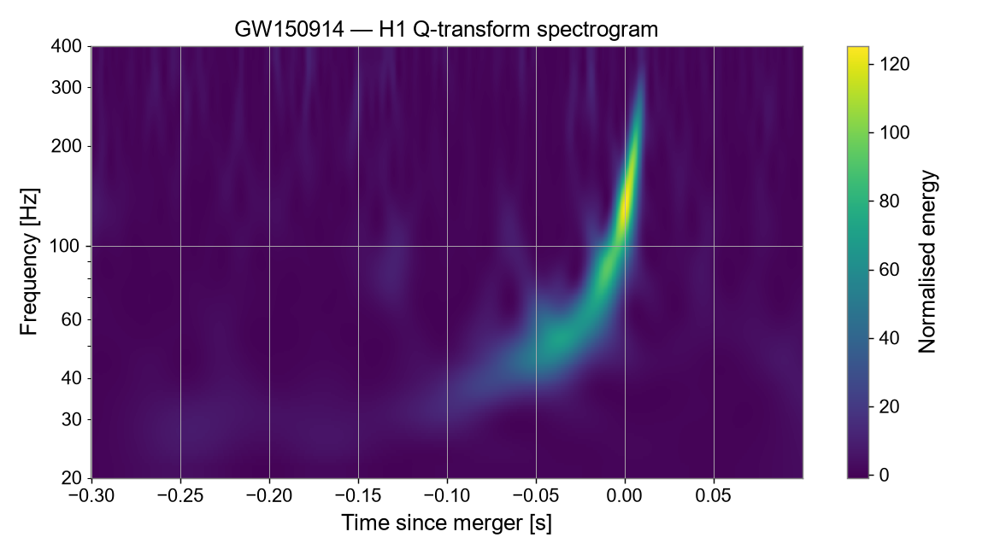
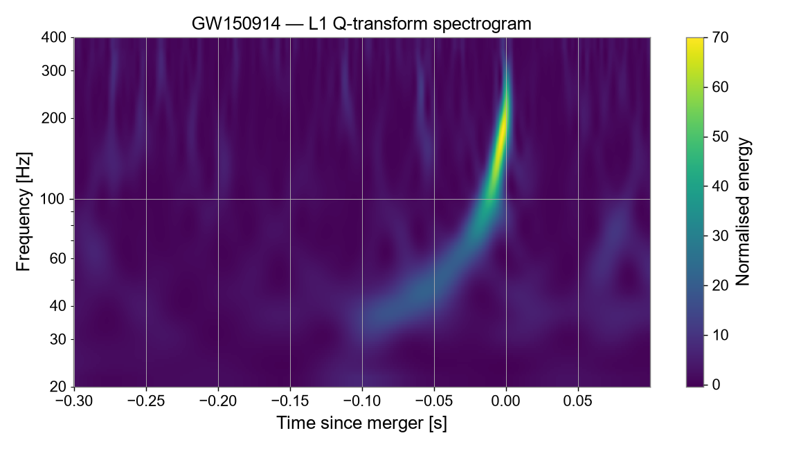

# GW150914 Reproduction — LIGO Open Data

A reproduction of the first direct detection of gravitational waves,
**GW150914** (binary black-hole merger, 14 September 2015;
[Abbott et al. 2016, *PRL* 116, 061102](https://doi.org/10.1103/PhysRevLett.116.061102)),
from public LIGO strain data released by the
[Gravitational Wave Open Science Center (GWOSC)](https://gwosc.org).

> This is a **reproduction** of a published result, not an original detection.
> It recovers the known signal from public data to confirm the analysis method
> end to end.

## What it does

`gw150914_reproduction.py` runs the full pipeline in Python with
[GWpy](https://gwpy.github.io):

1. **Fetch data:** downloads Hanford (H1) and Livingston (L1) O1 strain at
   4096 Hz from GWOSC and keeps a clean ±16 s window around the event (the
   long GWOSC files contain NaN gaps where a detector was not observing).
2. **Noise spectrum:** amplitude spectral density (ASD) of each detector.
3. **Whitening + band-pass (35–350 Hz):** flattens the noise spectrum and
   isolates the band where the chirp lives.
4. **Detector alignment:** shifts L1 by +6.9 ms and inverts its sign (light
   travel time between the sites and their different arm orientations), then
   overlays it on H1.
5. **Q-transform spectrograms:** time–frequency maps of each detector.

## Results

| | |
|---|---|
|  |  |
| **Noise curves.** Seismic wall below ~30 Hz, a floor near 10⁻²³ strain/√Hz over ~100–300 Hz, and narrow instrumental lines (e.g. suspension violin modes near 500 Hz and 1 kHz). | **Whitened, band-passed strain** in both detectors around the merger, before alignment: the signal is visible in each, but the two traces are offset in time and opposite in sign. |
|  |  |
| **H1 vs L1 aligned.** After the 6.9 ms shift and sign flip, the two independent detectors track each other through the final cycles around merger. | **H1 Q-transform.** The characteristic chirp sweeping from ~35 Hz to ~250 Hz and ending at merger. |



**L1 Q-transform.** The same chirp, weaker than in H1, consistent with the published result.

The time axis is measured from GPS 1126259462.42, the published merger time.

## Run it

Needs internet access for the first run (the GWOSC files are cached afterwards).

```bash
conda env create -f environment.yml
conda activate gw
python gw150914_reproduction.py
```

The figures are written to `figures/`.

On Windows, use conda (e.g. [Miniforge](https://github.com/conda-forge/miniforge))
rather than pip: some of GWpy's dependencies have no prebuilt Windows wheels
for recent Python versions and need a C++ compiler to build from source.

## What this does *not* do

- No matched-filter search and no signal-to-noise ratio estimate.
- No independent estimate of the black-hole masses or other source parameters.

The signal is made visible by whitening and band-passing, and its timing and
time–frequency structure are compared against the published result.

## Notes

The code was developed with AI assistance. I ran the analysis, checked the
outputs against the published figures, and interpreted the results.

## Acknowledgement

This work uses data obtained from the Gravitational Wave Open Science Center
(https://gwosc.org), a service of the LIGO Scientific Collaboration, the Virgo
Collaboration and KAGRA. See the
[GWOSC acknowledgement page](https://gwosc.org/acknowledgement/) for the full
acknowledgement text. The approach follows the GWOSC tutorials on signal
processing with GW150914.

## Author

Joshanraj C V · B.Sc. Physics, SRM Institute of Science and Technology, Chennai
